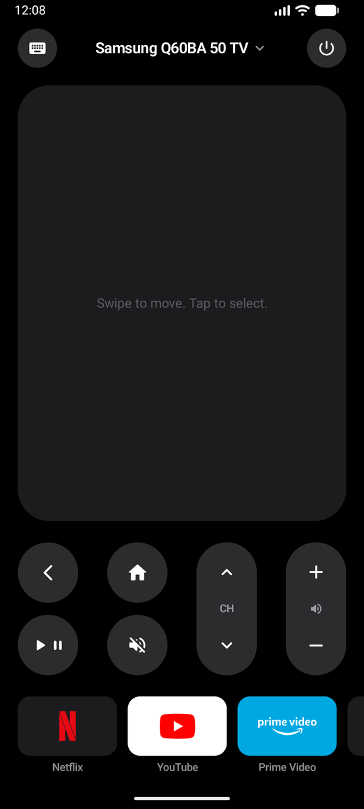
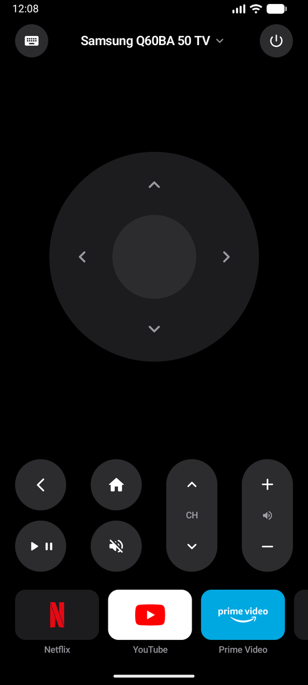
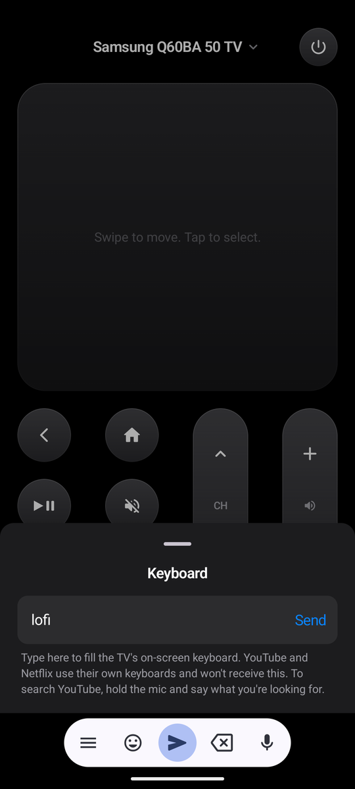
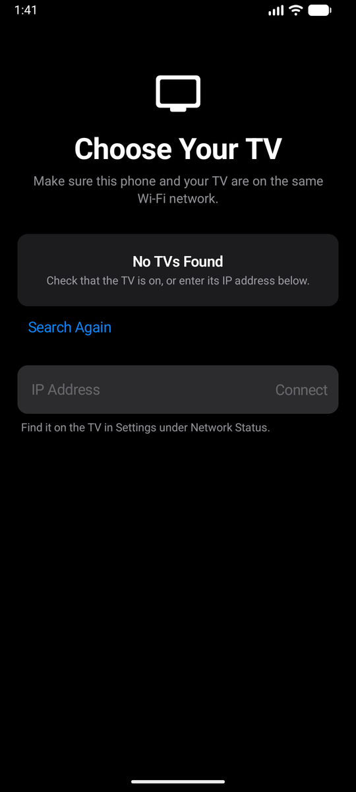

# Remote for Samsung TV

An Android remote for Samsung smart TVs, built for people whose physical remote has given up. It
talks to the TV over your home Wi-Fi. No ads, no account, and nothing leaves your network.

<p>
  
  
  
  
</p>

## Features

- **Touch surface.** Swipe to move around the TV, tap to select. Prefer buttons? Switch to a D-pad
  from the TV menu.
- **The keys you use every day.** Back, Home, Play/Pause, Mute, and capsule rockers for channel and
  volume. Hold a rocker to repeat.
- **Your phone's volume buttons** change the TV's volume while the app is open.
- **Quick open.** Tiles with each app's icon open Netflix, YouTube, Prime Video and others in one
  tap. You only see the apps installed on your TV.
- **Power.** Turns the TV off, and back on from standby or deep sleep.
- **Keyboard.** Type on your phone to fill the TV's on-screen keyboard in Browser, Settings and
  sign-in screens. YouTube and Netflix have their own keyboards and won't receive it.
- **Input Source and TV Settings** from the TV menu.
- **Finds your TV** on the network, or you can enter its IP address.

## Requirements

- A Samsung smart TV running Tizen, from 2016 or later. Tested on a 2022 Q60B (QA50Q60BAKLXL,
  Tizen 6.5).
- Android 8.0 or later.
- The phone and TV on the same Wi-Fi network.
- To turn the TV on from the app, switch on **Power On with Mobile** in the TV's network settings
  (under Expert Settings).

## Install

1. Download `TVRemote-1.0.0.apk` from the [latest release](https://github.com/ManasDedge08/samsung-tv-remote/releases/latest).
2. Open it on your phone and allow installs from that source when Android asks. Play Protect may
   warn about an app from outside the Play Store; choose **Install anyway**.
3. Open Remote, pick your TV, and select **Allow** on the TV within 30 seconds. You only do this
   once.

## How it works

| What | How |
| --- | --- |
| Keys and text | Secure WebSocket on port 8002, `samsung.remote.control` channel. The TV asks once to allow "Phone Remote" and returns a token, which the app saves. |
| App launch and installed check | REST on port 8001: `POST` / `GET /api/v2/applications/<id>`. The Q60B ignores the WebSocket `ed.apps.launch` call. |
| TV name, Wi-Fi MAC, power state | `GET http://<tv>:8001/api/v2/` |
| Power on | From light standby, the power key over the socket. From deep sleep, a Wake-on-LAN packet to the TV's Wi-Fi MAC. |
| Finding the TV | Probes port 8001 on every address in the phone's Wi-Fi subnet. |

### Security

The TV signs port 8002 with a self-signed certificate, so no certificate authority can vouch for
it. The app pins the certificate it sees when you pair (trust on first use) and refuses any other
one afterwards. If the TV's certificate changes, the app sends you back to setup to pair again.

The TV's REST API on port 8001 is plain HTTP, so the app allows cleartext traffic. It makes no
other network requests. The pairing token is excluded from backups and device transfers.

## Build

You need JDK 17 and the Android SDK with platform 35.

```sh
./gradlew assembleRelease
# app/build/outputs/apk/release/app-release.apk
```

Without a signing key the release build is signed with your local debug key, which is fine for
your own phone. To sign with your own key, create `keystore.properties` in the project root (it is
git-ignored):

```properties
storeFile=/path/to/your-release.jks
storePassword=...
keyAlias=...
keyPassword=...
```

Android installs an update only when it is signed with the same key as the installed copy. Builds
from the Releases page use the project's release key, so uninstall first if you switch between
those and your own build.

## Credits

App glyphs come from [Simple Icons](https://simpleicons.org) (CC0), converted to Android vector
drawables.

## Disclaimer

This is an independent project, not made by or affiliated with Samsung, Apple, Netflix, Google,
Amazon, Spotify or Plex. Their names and logos are trademarks of their respective owners and
appear only to label the apps the remote can open.

## License

[MIT](LICENSE)
